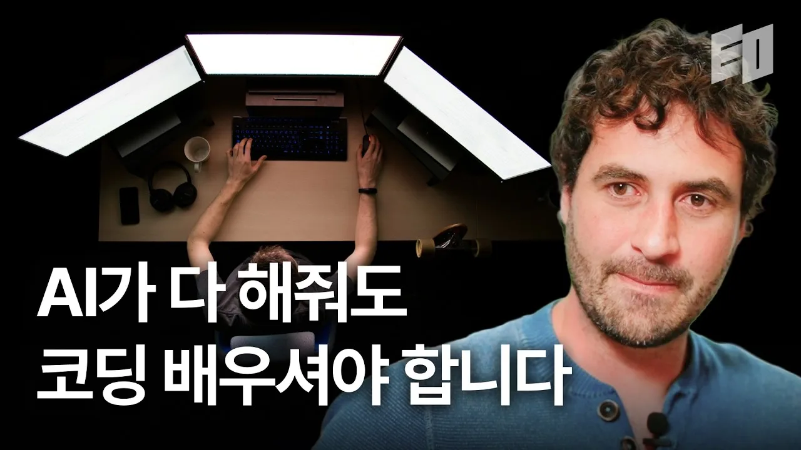

요즘 답을 받는 일이 엄청나게 쉬워졌다.
몇 초만 기다리면 그럴듯하거나 내가 몰랐던 새로운 답이 온다.
처음엔 사실 싫었다.
나를 대체하고 있는 느낌이 들었기 때문이다.
그치만 AI는 계속해서 발전하고 있고, AI가 가장 잘하는 것은 코딩이다.
이 사실을 부정하고 내 방식만 고수하다가 나는 대체될 수밖에 없을 것이다.
그래서 이 사실을 받아들이기로 했다.
그리고 지금은 즐기고 있는 것 같다.
아니 즐겨야만 한다.
하루에 처리하는 일의 양이 눈에 띄게 늘었고, 예전 같으면 며칠이나 걸릴 일을 몇 시간, 몇 분만에 끝내기도 한다.
그런데 어느 순간부터 내 몸 자체를 AI한테 맡기는 셈이 된 것 같더라.
만들어진 건 많은데 내 머리 속에는 쌓인 건 없는 것 같은 느낌.

정확히 언제부터였는지는 모르겠다.
내가 만든 걸 설명하지 못하는 순간이 오면서 확실해졌다.
짧은 시간 내에 빠르게 구현을 하고 결과물을 내야 하는 상황에서 결과물을 우선으로 생각했던 것이다.
동작은 잘 한다.
테스트도 잘 통과한다.
그런데 왜 이렇게 구현했고, 만들었는지 물으면 할 말이 없었다.
생각해보면 무서운 것은 잘못된 답을 받는 쪽이 아니었다.
잘못됐는지 알아볼 눈이 무뎌지는 쪽이었다.
판단을 오래 쉬면 판단하는 법을 잊는다는 걸 실감했다.
언제부터 판단을 위임하며 생각을 안했던걸까.

우연히 Youtube 영상으로 [Chris Piech라는 스탠포드 CS 교수의 인터뷰 영상](https://www.youtube.com/watch?v=_qYUwrJ_XHo)을 봤다.

AI가 코딩을 할 수 있으니 오히려 더 배워야 한다는 얘기였는데, 흔한 훈계겠거니 하고 틀었다가 끝까지 봤다.
이 분은 스탠포드의 무료 프로그래밍 강좌인 Code in Place를 운영하면서 6년 동안 실험을 반복했다고 한다.
학생들에게 AI를 서로 다른 양으로 쥐어주고, 그게 학습 능력과 동기에 어떤 영향을 주는지를 계속 관찰한 것이다.

결과가 예상과 좀 달랐다고 한다.
AI 튜터를 붙여줬더니 오히려 중도 포기하는 학생이 늘었다.
반대로 챗봇 대신 사람 교사를 연결해주는 팝업을 띄웠더니 완주율이 10%p 정도 올랐다.
재밌는 것은 AI가 틀린 답을 줘서가 아니라는 점이다.
답은 정확했다.
그런데도 사람이 붙었을 때 학생들이 더 끝까지 갔다.

교수의 진단은 지금의 챗봇이 답은 잘하지만 호기심을 일으키지는 못한다는 것이었다.
AI는 동기를 부여하지 못하고, 사람의 손길이 그걸 한다.
배움이라는 것이 정보를 받는 일이 아니라 계속하고 싶게 만드는 일이라면, AI는 아직 그 자리를 채우지 못하고 있는 셈이다.

나도 회사에서 동기 부여가 필요하다는 말을 자주 한다.
누군가 나를 설득시키는 말을 하면 그제서야 내면에서 열정 같은 것이 타오른다.

영상 내내 그가 반복하는 질문이 있었다.
당신은 AI와 함께 성장하고 있느냐는 것.
AI를 쓰는 게 문제가 아니라 쓰면서 내가 성장하고 있느냐가 문제라는 얘기였는데, 요즘 내가 품고 있던 찜찜함을 정확히 찌르는 말이었다.

그가 나눈 구분도 인상 깊었다.
문법은 AI가 곧 완벽하게 할 것이고, 사실 이미 거의 그렇다.
하지만 문제를 정의하고 쪼개는 일은 여전히 사람의 몫이라고 했다.
주니어 엔지니어의 진짜 기술도 코드를 치는 게 아니라 컴퓨터가 할 수 있는 것과 사람이 필요한 것 사이를 잇는 일이라는 말이 특히 그랬다.
듣고 나니 내가 최근에 막혔던 지점들은 코드가 아니었다는 것이 생각났다.
이게 진짜 풀어야 할 문제가 맞는지, 고객은 어떤 것을 보고 느낄 수 있는지, 지금 이 구조가 몇 달 뒤에도 버틸지, AI가 준 답이 똥인지 된장인지.
전부 코드를 치기 전에 벌어지는 일이고, 전부 생각하는 일이다.
프롬프트를 잘 쓰는 능력이라는 것은 결국 문제를 명확하게 정의하는 능력의 다른 말이지 않을까.

그래서 요즘은 논리적으로 사고하는 힘이 다시 중요해진 시기가 아닌가 싶다.
물론 이전에도 사고하는 힘은 중요했었을 것이다.
코드를 못 짜서 막히는 시대는 지나가고 있는데, 그럴수록 무엇을 왜 만들지 스스로 정리하지 못하는 사람과 그렇지 않은 사람의 차이는 오히려 더 벌어질 것이다.
도구가 격차를 없애줄 거라고 생각했는데, 실제로는 반대로 가고 있는 것처럼 보인다.

조금 역설적인데 CS 지식도 마찬가지다.
코드를 덜 쓸수록 오히려 더 필요해진다.
AI가 짠 코드를 읽고 판단하려면 결국 그 내부에 뭐가 있는지를 알아야 하기 때문이다.
SSO는 로그인 한 번으로 어떻게 여러 서비스를 통과시키는지, 이 쿼리는 왜 느린지, 이 구조가 왜 이 상황에 맞지 않는지, 동시성 문제가 왜 하필 여기서 터지는지 같은 것들.
만들 줄 아는 것과 판단할 줄 아는 것은 다른 능력인데, 앞으로 가치가 높아질 것은 후자일 것 같다.

그럼 어떻게 공부해야 하나를 요즘 생각하고 있다.
예전처럼 책 1장부터 순서대로 떼는 방식은 이제 맞지 않는 것 같다.
그렇게 쌓아 올릴 시간에 이미 무언가가 만들어져 있으니까.
그래서 top-down 방식을 택하고 있다.
일단 AI를 써서 빠르게 굴러가게 만들어 놓는다.
그 다음에 내가 이해한 대로 구조를 설명해보고, 틀린 부분을 강하게 지적해달라고 한다.
거기서 막히는 지점이 내 구멍이다.
그리고 그 구멍을 기준으로 아래로 파고 내려간다.
동기가 이미 붙어 있는 상태에서 파는 거라 머리 속에 남는다.
언젠가 쓸 것 같아서 배우는 것과 지금 이걸 몰라서 막혔다는 건 완전 다른 학습이었다.

결국 손이랑 속도는 빌려도 된다고 생각한다.
문제는 무얼 왜 만들지, 이게 맞는지 판단하는 일까지 넘길 때다.
그건 넘기는 순간 나한테 남는 게 없더라.
영상 마지막에 그가 어제보다 똑똑해졌는지를 확인하며 하루를 시작하라고 했는데, 결국 남는 질문은 AI를 얼마나 잘 쓰느냐가 아니라 그걸 쓰는 동안 내가 성장했냐는 것 같다.
