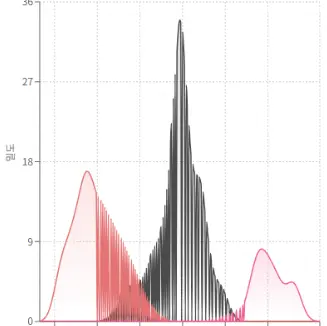
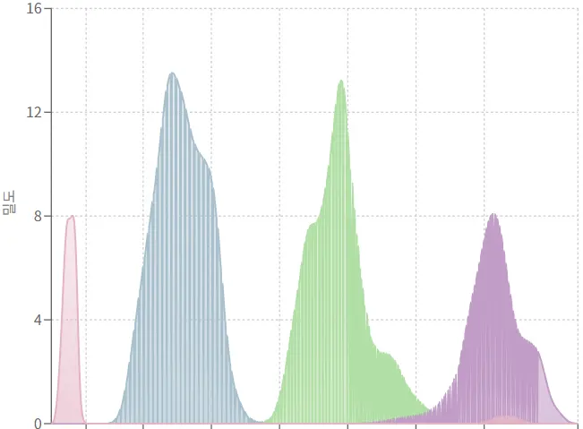
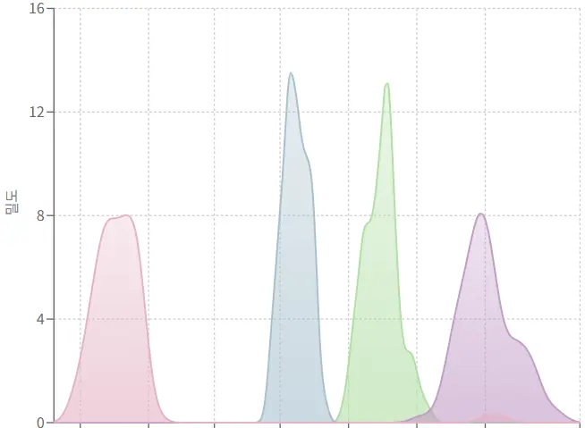

프로젝트에서 여러 그룹의 분포를 비교하는 KDE 차트를 구현했었다. 하나의 그룹만 표시할 때는 문제없이 부드러운 곡선이 그려졌는데, 여러 그룹이 겹치자마자 차트가 **세로 줄무늬 패턴**으로 깨져버렸다.

<div className="flex flex-col gap-4 sm:flex-row">
  <div className="min-w-0 flex-1">



  </div>
  <div className="min-w-0 flex-1">



  </div>
</div>

이게 뭐지? 분명히 KDE 계산 로직은 문제없이 동작하는데 왜 차트가 이렇게 깨질까? 원인을 찾아서 해결한 과정을 기록해보려고 한다.

## 문제 상황

여러 그룹의 데이터를 동시에 표시하면 차트가 이상하게 깨졌다. 단순히 UI가 약간 이상한 정도가 아니라 **아예 데이터를 알아볼 수 없을 정도**로 세로 줄무늬가 생기는 심각한 문제였다.

특히 데이터 범위가 비슷한 그룹들이 겹칠 때 더 심하게 나타났다. 분명히 각 그룹의 KDE는 개별적으로는 제대로 계산되고 있었는데 말이다.

## 원인 분석

문제의 원인을 찾기 위해 차트 데이터를 콘솔에 찍어봤다. 그런데 이상한 점을 발견했다.

```tsx
// 그룹 A의 x 좌표
[0, 0.1, 0.2, 0.3, ..., 10.0]

// 그룹 B의 x 좌표
[0, 0.09999, 0.19999, 0.29999, ..., 9.99999]
```

**각 그룹이 서로 다른 x 좌표 배열을 가지고 있었다.**

### 왜 x 좌표가 달라질까?

기존 KDE 계산 로직을 살펴보자.

```ts
export const calculateKDE = (
  data: number[],
  bandwidth?: number,
  samplePoints: number = 150,
): KDEPoint[] => {
  const h = bandwidth ?? calculateBandwidth(data);

  // 각 그룹마다 독립적으로 x 범위 계산
  const minVal = Math.min(...data);
  const maxVal = Math.max(...data);
  const padding = h * 3;
  const xMin = Math.max(0, minVal - padding);
  const xMax = maxVal + padding;

  // x 좌표 생성
  const step = (xMax - xMin) / samplePoints;
  for (let i = 0; i <= samplePoints; i++) {
    const x = xMin + i * step; // 이 부분이 문제
    // ...
  }
};
```

각 그룹마다 데이터 범위가 다르므로 `xMin`, `xMax`, `step`이 모두 달라진다. 결과적으로 생성되는 x 좌표가 미세하게 다른 것이다.

:::info{title="부동소수점 연산의 함정"}
JavaScript의 부동소수점 연산은 정확하지 않다. `0.1 + 0.2`가 `0.3`이 아니라 `0.30000000000000004`가 되는 것처럼 말이다.

각 그룹이 독립적으로 x 좌표를 계산하면서 이런 미세한 차이가 누적되어 완전히 다른 x 좌표 배열이 만들어진다.
:::

### 데이터 병합 과정의 문제

Recharts에 데이터를 전달하기 위해 다음과 같이 병합했었다.

```tsx
// 모든 x 값의 합집합 생성
const allXValues = new Set<number>();
kdeResults.forEach(({ kdePoints }) => {
  kdePoints.forEach(point => {
    allXValues.add(point.x);
  });
});

const sortedXValues = Array.from(allXValues).sort((a, b) => a - b);

// 각 x 값에 대해 각 그룹의 density 매핑
const chartData = sortedXValues.map(x => {
  const dataPoint: Record<string, number> = { x };
  kdeResults.forEach(({ groupKey, kdePoints }) => {
    const point = kdePoints.find(p => p.x === x); // 여기가 문제
    dataPoint[groupKey] = point ? point.density : 0;
  });
  return dataPoint;
});
```

`Set`에 추가할 때 부동소수점 값이 미세하게 다르면 중복으로 간주되지 않는다. 그래서..

- 그룹 A: 150개 포인트
- 그룹 B: 150개 포인트
- 합치면: 300개 포인트! (겹치는 게 거의 없음)

그리고 `kdePoints.find(p => p.x === x)`에서 `===` 비교를 하면 미세하게 다른 x 값들은 매칭되지 않아 `0`이 할당된다.

결과적으로 대부분의 포인트에서 어떤 그룹은 실제 밀도 값을 가지고, 다른 그룹은 `0`을 가지면서 Area 차트가 **0과 실제 값 사이를 빠르게 오가며 세로 줄무늬를 만들어낸 것**이다.

## 해결 방법

해결책은 간단하다. **모든 그룹이 동일한 x 좌표 배열을 공유**하면 된다.

### 1. KDE 함수에 공통 x 축 지원 추가

먼저 `calculateKDE` 함수에 선택적으로 x 좌표 배열을 받을 수 있도록 수정했다.

```ts
export const calculateKDE = (
  data: number[],
  bandwidth?: number,
  samplePoints: number = 150,
  xPoints?: number[], // 공통 x 축 배열
): KDEPoint[] => {
  if (data.length === 0) return [];

  const h = bandwidth ?? calculateBandwidth(data);
  const n = data.length;

  // xPoints가 제공된 경우 해당 포인트들에 대해서만 밀도 계산
  if (xPoints && xPoints.length > 0) {
    return xPoints.map(x => {
      let density = 0;
      for (const dataPoint of data) {
        const u = (x - dataPoint) / h;
        density += gaussianKernel(u);
      }
      density /= n * h;
      return { x, density };
    });
  }

  // xPoints가 없으면 기존 방식대로 동작
  // ...
};
```

하위 호환성을 유지하면서 새로운 기능을 추가했다. `xPoints`가 제공되면 해당 x 좌표에서만 밀도를 계산하고, 없으면 기존 방식대로 동작한다.

### 2. 공통 x 축 생성 로직

이제 여러 그룹의 KDE를 계산하기 전에 공통 x 축을 먼저 생성해야 한다.

```ts
// 1단계: 모든 그룹의 데이터를 수집하여 전체 범위 계산
const allDataPoints: number[] = [];
groupDataMap.forEach(dataPoints => {
  allDataPoints.push(...dataPoints);
});

const globalMin = Math.min(...allDataPoints);
const globalMax = Math.max(...allDataPoints);

// 평균 bandwidth 계산 (더 나은 padding을 위해)
const bandwidths = Array.from(groupDataMap.values()).map(data =>
  calculateBandwidth(data),
);
const avgBandwidth =
  bandwidths.reduce((sum, bw) => sum + bw, 0) / bandwidths.length;

// 2단계: 공통 x 축 생성
const padding = avgBandwidth * 3;
const xMin = Math.max(0, globalMin - padding);
const xMax = globalMax + padding;
const samplePoints = 150;
const step = (xMax - xMin) / samplePoints;

const commonXPoints: number[] = [];
for (let i = 0; i <= samplePoints; i++) {
  commonXPoints.push(xMin + i * step);
}
```

핵심은 **전체 데이터의 글로벌 범위를 기준으로 x 축을 딱 한 번만 생성**하는 것이다.

:::note{title="왜 평균 bandwidth를 사용하나요?"}
각 그룹의 bandwidth가 다를 수 있기 때문에 평균값을 사용해서 적절한 padding을 계산한다.

이렇게 하면 어떤 그룹의 KDE 곡선도 잘리지 않고 부드럽게 표시할 수 있다.
:::

### 3. 공통 x 축으로 KDE 계산

이제 각 그룹의 KDE를 공통 x 축을 사용해서 계산한다.

```ts
// 3단계: 각 그룹별로 공통 x축을 사용하여 KDE 계산
const kdeResults = Array.from(groupDataMap.entries()).map(
  ([groupKey, dataPoints], index) => {
    const kdePoints = calculateKDE(
      dataPoints,
      undefined,
      samplePoints,
      commonXPoints, // 공통 x 축 전달
    );
    const boxStats = calculateBoxPlotStats(dataPoints);
    const color = MACHINE_BAR_COLOR[index % MACHINE_BAR_COLOR.length];
    return {
      groupKey,
      kdePoints,
      color,
      boxStats,
    };
  },
);
```

모든 그룹이 동일한 `commonXPoints` 배열을 받아서 KDE를 계산한다. 이제 각 그룹의 `kdePoints`는 **정확히 같은 x 좌표**를 가진다.

### 4. 데이터 포맷 간소화

이제 데이터 병합이 훨씬 간단해진다.

```ts
// 4단계: Recharts용 데이터 포맷 (모든 그룹이 동일한 x 값 사용)
const chartData = commonXPoints.map(x => {
  const dataPoint: Record<string, number> = { x };
  kdeResults.forEach(({ groupKey, kdePoints }) => {
    const point = kdePoints.find(p => p.x === x);
    dataPoint[groupKey] = point ? point.density : 0;
  });
  return dataPoint;
});
```

사실 이제 `find`도 필요 없다. 모든 `kdePoints`의 순서가 `commonXPoints`와 동일하기 때문에 인덱스로 접근해도 된다.

```ts
const chartData = commonXPoints.map((x, index) => {
  const dataPoint: Record<string, number> = { x };
  kdeResults.forEach(({ groupKey, kdePoints }) => {
    dataPoint[groupKey] = kdePoints[index].density;
  });
  return dataPoint;
});
```

이렇게 하면 `find` 연산도 제거되어 성능도 개선된다.

## 결과

수정 후 차트가 완벽하게 작동한다.



여러 그룹의 KDE 곡선이 부드럽게 겹쳐서 표시되고, 세로 줄무늬는 완전히 사라졌다.

### 개선 효과

- 세로 줄무늬 패턴 완전 제거
- 부동소수점 정밀도 문제 해결
- 불필요한 데이터 포인트 폭발 방지 (300개 → 150개)
- `find` 연산 제거로 성능 개선
- 부드러운 곡선 렌더링

## 배운 점

이번 버그를 해결하면서 몇 가지 중요한 교훈을 얻었다.

### 1. 부동소수점 연산의 한계

JavaScript(그리고 대부분의 프로그래밍 언어)에서 부동소수점 연산은 정확하지 않다. 비교 연산을 할 때는 항상 이를 염두에 두어야 한다.

```ts
// 나쁜 예
if (a === b) { ... }

// 좋은 예 (허용 오차 사용)
const EPSILON = 0.0001;
if (Math.abs(a - b) < EPSILON) { ... }
```

하지만 더 좋은 방법은 이번처럼 **애초에 같은 값을 공유**하는 것인 것 같다.

### 2. 데이터 시각화에서 좌표계 통일의 중요성

여러 데이터셋을 하나의 차트에 표시할 때는 **공통 좌표계를 사용**하는 것이 핵심이다. 각각 독립적으로 계산하면 정렬, 병합, 비교 과정에서 문제가 발생할 수 있다.

### 3. 하위 호환성 유지

기존 코드를 수정할 때는 항상 하위 호환성을 고려해야 한다. `xPoints` 파라미터를 optional로 만들어서 기존 코드가 깨지지 않도록 했다.

```ts
// 기존 코드는 그대로 동작
const kde = calculateKDE(data);

// 새로운 기능도 사용 가능
const kde = calculateKDE(data, undefined, 150, commonXPoints);
```

## 마무리

처음에는 단순한 렌더링 버그인 줄 알았는데, 파고들어 보니 부동소수점 연산과 데이터 병합 로직의 근본적인 문제였다.

문제의 원인을 정확히 이해하고 나니 해결책은 생각보다 간단했다. **공통 x 축을 사용하자!**

이번 경험을 통해 데이터 시각화에서 좌표계 통일이 얼마나 중요한지 깨달았으며 버그를 해결하는 과정에서 코드의 품질도 함께 개선할 수 있었다.
